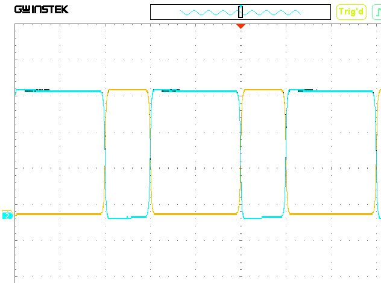
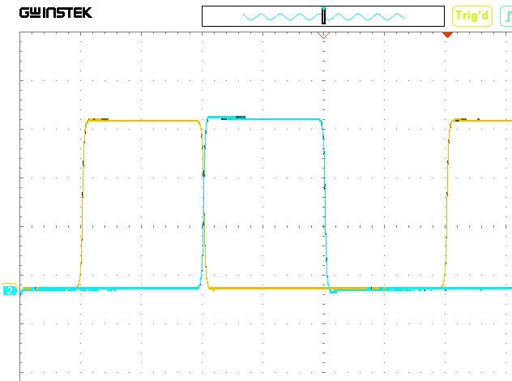

# STM32 Precision Timing Generator

English | [简体中文](README_CN.md)

A three-channel, nanosecond-resolution timing waveform generator built on STM32F103C8T6. All three channels are produced by hardware timer output-compare on a single timer — no software bit-banging, no FPGA, no HAL library.

## Features

- **Three synchronized channels** from one timer (TIM2 CH2/CH3/CH4) — no inter-timer phase drift
- **13.9 ns edge resolution** at 72 MHz timer clock (PSC = 0)
- **PWM1 + PWM2 combination** produces a window that a single PWM mode cannot
- **Deterministic startup**: outputs are forced low before pins are handed to the timer, avoiding power-on glitches
- **Ringing-aware GPIO config**: 2 MHz drive strength instead of 50 MHz for clean edges on long wires
- **UART command protocol** (115200 8N1) for runtime frequency set/read, start/stop and status readback — frame format in `docs/PROTOCOL.md`
- **Board LED (PC13)** lights after all init completes, so a lit LED means the main loop was reached
- Bare-metal register-level implementation (no HAL dependency), Keil MDK / armclang

## Hardware

| Item | Value |
|---|---|
| MCU | STM32F103C8T6 (Cortex-M3, 72 MHz) |
| Debugger | ST-Link V2 (SWD: PA13 / PA14) |
| Host link | USART1: PA9 = TX, PA10 = RX, 115200 8N1 (via CH340) |
| Indicator | PC13 onboard LED, active low |
| Channels | PA1 = CH1, PA2 = CH2, PA3 = CH3 |
| Timer | TIM2, CH2 / CH3 / CH4 |
| Logic level | 3.3 V |

Wiring: connect PA1 / PA2 / PA3 to the scope probes and GND to the board ground. Trigger on PA1 rising edge, timebase 1 us/div.

## Timing specification

| Parameter | Value |
|---|---|
| Timer clock | 72 MHz, PSC = 0 |
| One tick | 2 us = 144 counts |
| Period | 3 ticks = 432 counts, ARR = 431 |
| CH1 (PA1) | high [0, 288) counts — PWM1 |
| CH2 (PA2) | high [0, 144) counts — PWM1 |
| CH3 (PA3) | high [288, 432) counts — PWM2 |

All three channels share one time base. The falling edge of CH1 and the rising edge of CH3 occur at the same counter value (288), so they are aligned by hardware rather than by software delay.

The default frequency is 166666 Hz (6 us period, ARR = 432 counts) and is runtime-configurable over UART. Changing the period preserves the 2:1:2 ratio across the three channels. See `docs/PROTOCOL.md` for the command set.

## Quick start

1. Open `firmware/target/timing-generator.uvprojx` in Keil MDK (armclang V6.24, STM32F1xx DFP 2.4.1)
2. Build — expect `0 Error, 0 Warning`
3. Flash with ST-Link V2 (SWD). After flashing, press RST once: the PC13 LED lights, confirming init completed and the main loop is running
4. Connect oscilloscope probes to PA1 / PA2 / PA3, common ground; trigger on PA1 rising edge, timebase 1 us/div
5. For host control, wire CH340 to the board (TXD to PA10, RXD to PA9, GND to GND) and run `tools/uart_probe.py` (see below)

Expected waveform: PA1 high 4 us / low 2 us; PA2 high 2 us; PA3 high 2 us aligned with PA1 falling edge; period 6 us.

### Serial link check

`tools/uart_probe.py` is a standalone PC-side probe (pyserial only, no host app required):

```bash
python tools/uart_probe.py selftest                      # verify CRC / framing against PROTOCOL.md vectors, no hardware
python tools/uart_probe.py loopback --port COM10         # short CH340 TXD-RXD to verify the PC-side chain
python tools/uart_probe.py probe --port COM10 --cmd GET_STATUS
python tools/uart_probe.py probe --port COM10 --cmd SET_PARAM --freq 100000
```

`selftest` checks all 10 request/response vectors and the resync logic without touching the board — useful as a quick regression check after any protocol change.

## Design decisions (the part worth talking about)

### Why one timer is enough

An earlier two-timer version placed the third channel's active window in the *middle* of the period. Standard PWM can only produce a window anchored at the start (PWM1) or at the end (PWM2) of a period — a middle window required a second timer with a phase preset, plus a tricky failure mode when the trigger signal was a long level.

In this version the third channel's window was moved to the **end of the period**, so PWM2 generates it directly. One timer, three channels, zero software phase correction.

> Q&A follow-up: to move the window back to the middle, use a second timer with a phase preset (as before) or a one-pulse mode with an update interrupt. Both cost an extra timer and introduce software jitter.

### Why 2 MHz drive strength, not 50 MHz

3.3 V logic at 166.7 kHz does not need 2–3 ns edges. The 50 MHz drive setting produced severe ringing and crosstalk on long jumper wires; dropping to the 2 MHz setting (~30–50 ns edges) removed most of it.

### Why outputs are forced low first

On reset, GPIOs default to floating inputs. If the timer is enabled before the pins are configured, the outputs may glitch high. The firmware writes all outputs low first, configures them as push-pull, and only then hands them to the alternate function.

> Note B in the source: with PWM2, the third channel's falling edge is the period end (ARR), not a compare value. Adding an idle gap by simply stretching the period stretches that channel high through the gap. See `main.c` for the three correct ways to add a gap.

## Verification

Measured on real hardware with a two-channel scope (the three channels are
verified pairwise; together the two captures cover every pairwise relation):



PA1 high 4 us / PA3 high 2 us, perfectly complementary — the falling edge of
PA1 and the rising edge of PA3 are aligned by hardware at the same counter
value, with no software delay.



PA2 high 2 us / PA3 high 2 us, with the 2 us all-low gap between them, and
PA3's falling edge coinciding with the next period's PA2 rising edge.

### Serial protocol (host link)

Verified on real hardware through a CH340 link at 115200 8N1. All commands were
exercised end-to-end, including a set-then-read-back round trip:

| Command | Response | Decoded |
|---|---|---|
| `GET_STATUS` | `AA 55 07 85 00 01 02 8B 0A 00 9F D7` | run=1, freq=166666 Hz, err=0 |
| `SET_PARAM 100000 Hz` | `AA 55 02 81 00 B0 50` | OK |
| `GET_PARAM` (after set) | `AA 55 05 82 00 01 86 A0 4B 88` | freq=100000 Hz — write took effect |
| `STOP` then `GET_STATUS` | `AA 55 07 85 00 00 01 86 A0 00 4D 30` | run=0 — state tracked |
| `START` then `GET_STATUS` | `AA 55 07 85 00 01 02 8B 0A 00 9F D7` | run=1, freq restored |

The `GET_STATUS` response is byte-identical to the reference vector in
`docs/PROTOCOL.md`, confirming frame layout, CRC, state machine, dispatch and
big-endian encoding all agree between firmware and documentation.

- [x] Waveform captures with readable timebase (see `assets/`)
- [x] Serial protocol verified end-to-end (all commands + round trip)
- [ ] Single three-channel capture (needs a 4-channel scope)
- [ ] "Set vs measured" error table (target < 0.5%) — needs input-capture or scope

## Project structure

```
firmware/
  target/   final, buildable firmware and Keil project (this project)
  target/v4origin_app/  shared protocol header (protocol.h) for firmware + host
docs/       design notes (PROTOCOL.md is the authoritative frame spec)
assets/     oscilloscope captures and diagrams
tools/      uart_probe.py — PC-side serial probe (selftest / loopback / probe)
```

## Roadmap

- [x] Fixed-frequency three-channel waveform
- [x] UART parameter configuration (frequency set/read, start/stop, status)
- [x] PC-side serial probe tool (protocol regression + link check)
- [x] Input-capture self-check (TIM3/PA6; requires a PA1→PA6 jumper)
- [ ] PC host tool in C++ (serial port + frame protocol + CSV export)
- [ ] Three-channel simultaneous capture (needs a 4-channel scope)

## Contributing

This project is mirrored on both GitHub and Gitea. **For collaborators: see
[MAINTENANCE.md](MAINTENANCE.md)** for authentication, dual-remote push, and
troubleshooting before making changes.

## License

MIT — see [LICENSE](LICENSE).
