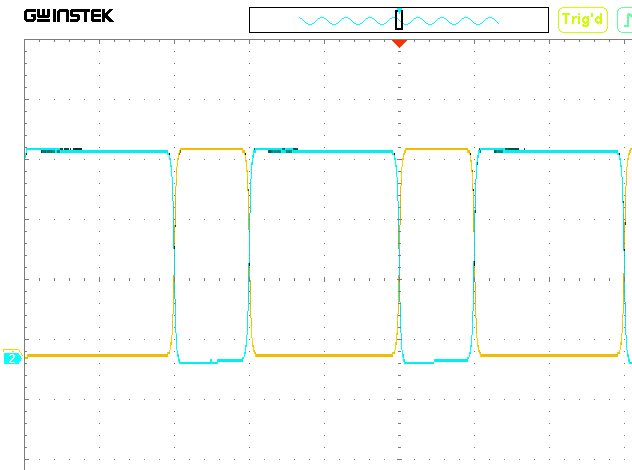
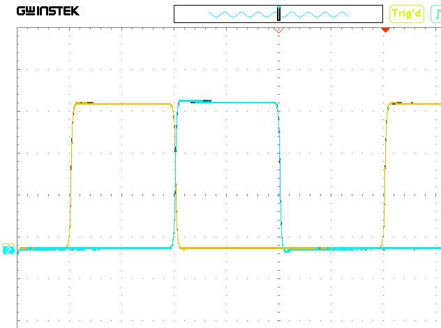

# STM32 精密时序发生器

基于 STM32F103C8T6 的三通道、纳秒级时序波形发生器。三路波形全部由**单一定时器**的输出比较硬件产生——没有软件翻转 IO，没有 FPGA，也不依赖 HAL 库。

[English](README.md) | 简体中文

## 特性

- **三路严格同步**：同一个定时器（TIM2 CH2/CH3/CH4）产出，通道间不存在定时器相位漂移
- **13.9 ns 边沿分辨率**：定时器时钟 72 MHz，预分频 PSC = 0
- **PWM1 + PWM2 组合**：能产生单一 PWM 模式做不到的"窗口"波形
- **确定性启动**：引脚交给定时器之前先强制拉低，避免上电瞬间的毛刺
- **抗振铃的 GPIO 配置**：用 2 MHz 驱动档而非 50 MHz，长导线上的边沿更干净
- **串口命令协议**（115200 8N1）：运行时设定/回读频率、启停、状态查询——帧格式见 `docs/PROTOCOL.md`
- **板载 LED（PC13）**：全部初始化完成后点亮，灯亮即代表已进入主循环
- **裸机寄存器实现**（无 HAL 依赖），Keil MDK / armclang 编译

## 硬件

| 项目 | 参数 |
|---|---|
| 单片机 | STM32F103C8T6（Cortex-M3，72 MHz） |
| 调试器 | ST-Link V2（SWD：PA13 / PA14） |
| 上位机链路 | USART1：PA9 = TX，PA10 = RX，115200 8N1（经 CH340） |
| 指示灯 | PC13 板载 LED，低电平点亮 |
| 通道 | PA1 = CH1，PA2 = CH2，PA3 = CH3 |
| 定时器 | TIM2，CH2 / CH3 / CH4 |
| 逻辑电平 | 3.3 V |

接线：把 PA1 / PA2 / PA3 接到示波器探头，GND 接板子地。触发源选 PA1 上升沿，时基 1 µs/格。

## 时序规格

| 参数 | 数值 |
|---|---|
| 定时器时钟 | 72 MHz，PSC = 0 |
| 1 tick | 2 µs = 144 个计数 |
| 周期 | 3 tick = 432 个计数，ARR = 431 |
| CH1（PA1） | 在 [0, 288) 计数区间为高——PWM1 |
| CH2（PA2） | 在 [0, 144) 计数区间为高——PWM1 |
| CH3（PA3） | 在 [288, 432) 计数区间为高——PWM2 |

三路共用同一个时基。CH1 的下降沿与 CH3 的上升沿发生在同一个计数值（288），因此是**硬件对齐**的，不靠软件延时凑。

默认频率 166666 Hz（周期 6 µs，ARR = 432 个计数），可通过串口在运行时修改；改变周期时三路通道保持 2:1:2 的比例。命令集见 `docs/PROTOCOL.md`。

## 快速上手

1. 用 Keil MDK 打开 `firmware/target/timing-generator.uvprojx`（armclang V6.24，STM32F1xx DFP 2.4.1）
2. 编译——应为 `0 Error, 0 Warning`
3. 用 ST-Link V2（SWD）烧录。烧完按一下 RST：PC13 灯亮，说明初始化完成、主循环已在运行
4. 示波器探头接 PA1 / PA2 / PA3，共地；触发源选 PA1 上升沿，时基 1 µs/格
5. 若需上位机控制：CH340 接到板子（TXD→PA10，RXD→PA9，GND→GND），运行 `tools/uart_probe.py`（见下）

预期波形：PA1 高 4 µs / 低 2 µs；PA2 高 2 µs；PA3 高 2 µs 且与 PA1 下降沿对齐；周期 6 µs。

### 串口链路自检

`tools/uart_probe.py` 是独立的 PC 侧探测工具（只依赖 pyserial，不需要上位机本体）：

```bash
python tools/uart_probe.py selftest                      # 用 PROTOCOL.md 的向量校验 CRC/组帧，无需硬件
python tools/uart_probe.py loopback --port COM10         # 短接 CH340 的 TXD-RXD，验证 PC 侧链路
python tools/uart_probe.py probe --port COM10 --cmd GET_STATUS
python tools/uart_probe.py probe --port COM10 --cmd SET_PARAM --freq 100000
```

`selftest` 会核对全部 10 条请求/响应向量以及重新同步逻辑，完全不碰板子——协议改动后拿它做回归最快。

## 设计决策（最值得讲的部分）

### 为什么一个定时器就够了

早先的双定时器版本把第三路的有效窗口放在周期的**中间**。标准 PWM 只能产生"锚定在周期开头（PWM1）"或"锚定在周期结尾（PWM2）"的窗口——中间的窗口需要一个带相位预置的第二个定时器，而且触发信号为长电平时有个棘手的失效模式。

这一版把第三路的窗口挪到了**周期末尾**，于是 PWM2 可以直接产生它。一个定时器、三路通道、零软件相位修正。

> 延伸问答：若要把窗口挪回中间，可以用带相位预置的第二个定时器（如旧版），或者用单脉冲模式配合更新中断。两者都要多占一个定时器并引入软件抖动。

### 为什么用 2 MHz 驱动档而不是 50 MHz

166.7 kHz 的 3.3 V 逻辑并不需要 2–3 ns 的边沿。50 MHz 驱动档在长杜邦线上产生严重振铃和串扰；降到 2 MHz 档（边沿约 30–50 ns）后大部分振铃消失。

### 为什么先强制拉低输出

复位时 GPIO 默认是浮空输入。如果在引脚配置好之前就使能定时器，输出可能瞬间毛刺为高。固件先把所有输出写低、配成推挽，然后才交给复用功能。

> 源码里的备注 B：PWM2 的第三路下降沿是周期终点（ARR），而不是某个比较值。若简单地拉长周期来加空闲间隔，这一路会在整个间隔里保持高电平。源码 `main.c` 里给出了三种正确的加间隔方法。

## 验证

已在真实硬件上用双通道示波器实测（三路信号两两配对验证，两张照片合计覆盖全部通道间时序关系）：



PA1 高 4µs / PA3 高 2µs，两路完全反相——PA1 下降沿与 PA3 上升沿由硬件在同一计数值对齐，无软件延时。



PA2 高 2µs / PA3 高 2µs，两路之间有 2µs 全低间隔，PA3 下降沿与下一周期 PA2 上升沿重合。

### 串口协议（上位机链路）

已在真实硬件上通过 CH340、115200 8N1 全程验证，并做了"设定—回读"闭环：

| 命令 | 响应 | 解析 |
|---|---|---|
| `GET_STATUS` | `AA 55 07 85 00 01 02 8B 0A 00 9F D7` | run=1，freq=166666 Hz，err=0 |
| `SET_PARAM 100000 Hz` | `AA 55 02 81 00 B0 50` | OK |
| `GET_PARAM`（设定后） | `AA 55 05 82 00 01 86 A0 4B 88` | freq=100000 Hz——写入确实生效 |
| `STOP` 后 `GET_STATUS` | `AA 55 07 85 00 00 01 86 A0 00 4D 30` | run=0——状态同步 |
| `START` 后 `GET_STATUS` | `AA 55 07 85 00 01 02 8B 0A 00 9F D7` | run=1，频率恢复 |

`GET_STATUS` 的响应与 `docs/PROTOCOL.md` 中的参考向量**逐字节一致**，说明帧格式、CRC、状态机、命令分发与大端编码在固件和文档之间完全对齐。

### 实测频率误差（输入捕获）

`SELF_TEST` 在 PA6 上实测真实输出周期（TIM3 输入捕获，13.9 ns/计数，取 N 个周期平均，N 自适应以保证测量窗口落在 16 位计数器的一次计数范围内），并把与设定值的偏差以千分比返回。

| 设定 (Hz) | 周期(计数) | N | 实测误差 | 理论值 |
|---|---|---|---|---|
| 166666 | 432 | 16 | 0 ‰ | 0 ‰ |
| 100000 | 720 | 16 | 0 ‰ | 0 ‰ |
| 12345 | 5832 | 10 | 0 ‰ | 0 ‰ |
| 5000 | 14400 | 4 | 0 ‰ | 0 ‰ |
| 650000 | 110 | 16 | 6 ‰ | 6 ‰ |
| 700000 | 102 | 16 | 8 ‰ | 8 ‰ |

六组全部与理论吻合。残余误差来自**整数分频的量化，不是抖动**：650000 Hz 理论需要 110.77 个计数，取整为 110，于是实际是 654545 Hz。能被 72 MHz 整除的频率实测都是 0 ‰。默认的 166666 Hz 量化误差仅 0.004 ‰，远优于 0.5%（5 ‰）的目标。

- [x] 波形照片，时基清晰可读（见 `assets/`）
- [x] 串口协议端到端验证（全部命令 + 闭环回读）
- [x] "设定值 vs 实测值"误差表（输入捕获实测，见上表）
- [ ] 三通道同屏单张照片（需要四通道示波器）

## 项目结构

```
firmware/
  target/   最终可编译的固件与 Keil 工程（本项目）
  target/v4origin_app/  共享协议头（protocol.h），供固件与上位机共用
docs/       设计笔记（PROTOCOL.md 是帧格式的唯一权威）
assets/     示波器照片与示意图
tools/      uart_probe.py——PC 侧串口探测工具（自检/回环/协议探测）
```

## 路线图

- [x] 固定频率三通道波形
- [x] 串口参数配置（频率设定/回读、启停、状态查询）
- [x] PC 侧串口探测工具（协议回归 + 链路自检）
- [x] 输入捕获自检（TIM3/PA6，需一根 PA1→PA6 跳线）
- [ ] C++ 上位机工具（串口 + 帧协议 + CSV 导出）
- [ ] 三通道同屏捕获（需要四通道示波器）

## 贡献

本项目在 GitHub 与 Gitea 双端镜像。**协作者在改动前请阅读
[MAINTENANCE.md](MAINTENANCE.md)**，了解认证方式、双端推送与故障排查。

## 许可证

MIT——见 [LICENSE](LICENSE)。
